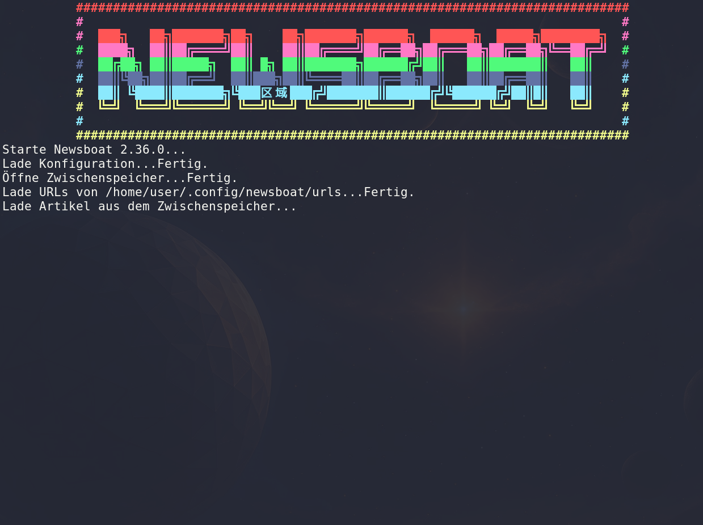

# ⚡ NEWSBOAT RAINBOW BANNER

### 🌈 BOLD ANSI RAINBOW ASCII LAUNCHER FOR `newsboat`.



- **The Signal:** Raw RSS feeds without algorithmic noise. Launches with a vivid ANSI rainbow boot splash. 📡
- **The Layout:** Dynamically reads terminal columns (`tput cols`) to center the banner cleanly in your terminal window.
- **The Launch:** Clears the screen, displays the multi-color ASCII header for 1.2s, and drops straight into `newsboat`. ⚡

## 🖥️ Command & Alias

| Alias | Executes | Description |
| :--- | :--- | :--- |
| **`nb`** | `command newsboat` | Clears terminal, renders centered rainbow banner & launches `newsboat` |

## 🚀 Quick Install

### One-Liner (via `curl`)
```bash
curl -fsSL https://github.com/postsonde/newsboat-banner/install_newsboat_banner.sh | bash && source ~/.bashrc
```

### Manual Install
```bash
git clone https://github.com/postsonde/newsboat-banner/install_newsboat_banner.sh
cd newsboat-banner
chmod +x install_newsboat_banner.sh
./install_newsboat_banner.sh
source ~/.bashrc
```

Run it with:
```bash
nb
```

## ⚙️ Requirements

- `bash` (Debian / Linux)
- [`newsboat`](https://newsboat.org)

---
*Built on Linux by [@postsonde](https://github.com/postsonde) — Trust the code, not the pixels.* 🧛‍♂️
